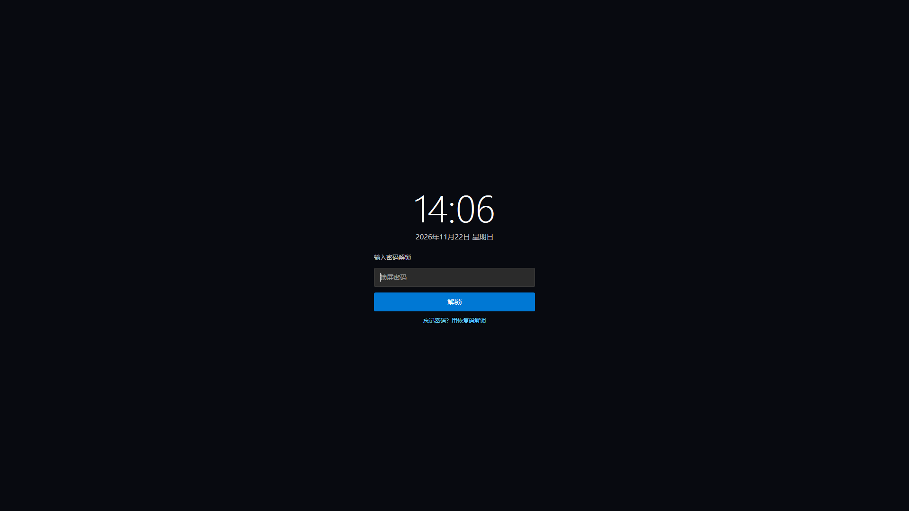
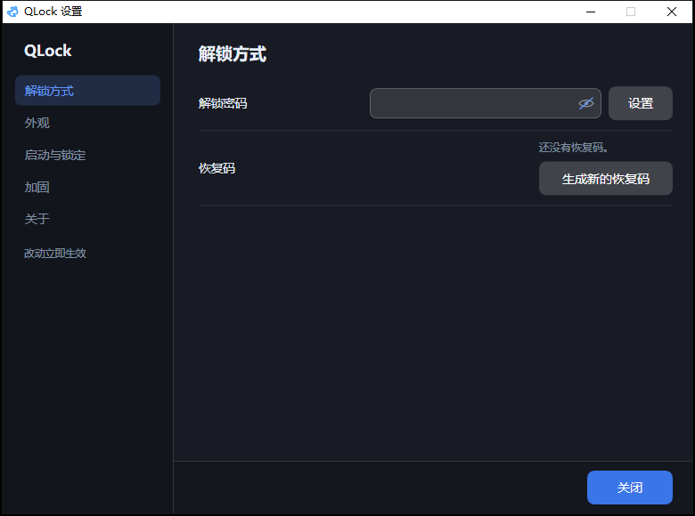

# QLock

QLock 是一个 Windows 桌面锁屏程序：把当前屏幕拍成模糊快照当背景，盖上时钟和密码框，用自己的密码解锁。
它不调用 `LockWorkStation`，不进入 Windows 的锁定状态——锁的是屏幕，不是 Windows 账户。

> 版本 0.1.0 · [MIT](LICENSE) · 未签名（SmartScreen 会提示"未知发布者"）

## 截图

## 安装

1. 下载 `QLock-0.1.0.zip`（exe + README + LICENSE）或裸 `QLock.exe`，放到一个不会被随手清掉的目录（开机自启指向的就是这个路径，别留在下载目录）
2. 双击 `QLock.exe`：首次运行没有密码，会自动打开设置窗 → 设置解锁密码 → 保存
3. 需要开机自启，就在设置里勾「登录时自动启动」再保存（只写当前用户的 Run 项，不需要管理员）

校验下载：`Get-FileHash QLock.exe -Algorithm SHA256`，与 `SHA256SUMS.txt` 对照。
升级：退出程序 → 覆盖 `QLock.exe`；配置在用户目录，不会丢。

**系统要求**：Windows 10 1903+ / Windows 11，需要 .NET Framework 4.8（这些系统已内置）。

## 使用

### 锁定

- 托盘图标双击 / 右键「立即锁定」
- `QLock.exe --lock`
- Win+L（默认接管；程序没在跑时仍是系统锁屏）
- Ctrl+Alt+L（可关）
- 空闲 N 分钟自动锁定（0 = 关闭）
- 启动后立即锁定（可选）

### 解锁

- 输入密码 → Enter 或点「解锁」
- 忘记密码：点「忘记密码？用恢复码解锁」→ 输入恢复码 → 解锁并打开设置窗。恢复码只显示一次、只能用一次
- 连错 3 次起短时禁用输入（每次 +1 秒，最多 10 秒），恢复码输错同样计数

### 设置项

| 分区 | 内容 |
| --- | --- |
| 解锁密码 | 单个输入框（≥ 4 位），右侧眼睛按钮可切换明文 |
| 恢复码 | 「生成新的恢复码」，只显示一次并自动复制到剪贴板 |
| 锁定触发方式 | 接管 Win+L、Ctrl+Alt+L、启动即锁、空闲 N 分钟 |
| 外观 | 显示时钟、用屏幕截图做模糊背景、提示文字 |
| 加固 | 拦截系统热键 |
| 开机自启 | 登录时自动启动、以管理员身份启动 |

改完点「保存」，「关闭」丢弃未保存的修改。

### 命令行

| 参数 | 作用 |
| --- | --- |
| （无） | 常驻托盘 |
| `--lock` | 立即锁定（已有实例时把指令转给它） |
| `--settings` | 打开设置窗 |
| `--demo` | 演示锁屏 10 秒后自动退出，不需要密码 |

## 文件位置

- 配置：`%APPDATA%\QLock\config.json`（只存密码 Hash 与 Salt，没有明文）
- 日志：`%LOCALAPPDATA%\QLock\qlock.log`（超过 512 KB 自动重建）

## 卸载

1. 托盘右键 → 退出（先退出再删文件）
2. 设置里取消「登录时自动启动」并保存；忘了这一步就手动删注册表值 `HKCU\Software\Microsoft\Windows\CurrentVersion\Run` 下的 `QLock`
3. 删除程序目录，以及 `%APPDATA%\QLock`、`%LOCALAPPDATA%\QLock`

## 必须配合的系统设置

QLock 只管自己的锁屏。系统的锁屏一旦触发，仍然会出现 Windows 登录界面。想让它不再出现：

1. 设置 → 账户 → 登录选项 →「如果离开了电脑，Windows 何时要求你重新登录」→ **从不**
2. 设置 → 个性化 → 锁屏界面 → 屏幕保护程序 → **无**（或勾掉"在恢复时显示登录屏幕"）
3. 控制面板 → 电源选项 →「唤醒时需要密码」→ **不需要密码**（笔记本"电池"与"接通电源"两处都要改）
4. 域/组策略下发的 `Machine inactivity limit` 这类策略客户端改不了，在受管机器上 QLock 只能减少系统锁屏出现的次数

## 锁屏时能挡住多少

- 键盘钩子吞掉 Win 系热键、Alt+Tab、Ctrl+Esc、Ctrl+Shift+Esc、Alt+F4；覆盖层一旦失去前台会立即抢回，抢回期间的按键全部丢弃，不会漏进后面的窗口
- 勾「以管理员身份启动」后，普通权限的任务管理器结束不了它。该选项默认关闭，只在启动时生效（Windows 不允许给已运行的进程提权），不在管理员组时勾了也没用
- **挡不住 Ctrl+Alt+Del 安全界面**：从那里结束进程或运行 `taskkill` 都能直接解开。这个程序是用来挡住顺手看屏幕的，不是安全边界

## 已知限制

- **软锁，不是安全边界**：结束进程即解锁；注销、重启、切换用户同样绕过
- 覆盖层必须持有前台才收键。远程控制软件抢前台时会表现为"打字没反应"；程序在每次失去前台时都会立即抢回，仍不行时日志里会有 `input blocked, overlay without foreground, current='…' (…)` 一行
- **未签名**：SmartScreen 或杀软可能拦一次，加信任区或用 SHA256 校验自行判断
- 只有主屏可交互，其余屏幕只显示背景与时钟
- 锁屏期间插拔显示器或改分辨率会重建覆盖层，布局没变时只重新置顶
- 开机自启指向 exe 的绝对路径，挪动程序目录后要在设置里重新保存一次

## 资源占用

实测（20 核机器，CPU 为单核百分比）：

| 状态 | CPU | 工作集 | 线程 | 句柄 |
| --- | --- | --- | --- | --- |
| 常驻托盘 | ~0% | 33 MB | 11 | 274 |
| 锁屏中 | 0.4% | 94 MB | 32 | 740 |
| 解锁后 | ~0% | 3–6 MB | 31 | 713 |

锁屏时多出的约 60 MB 来自每块屏幕一个全屏窗口、1/4 缩略图与高斯模糊的渲染目标；解锁后工作集会立刻被压回去。

## 从源码构建

- 不需要 Visual Studio、NuGet 或项目文件，直接用系统的 `csc.exe`：
  - `build.cmd` → `bin\QLock.exe`
  - `test.cmd` → 构建并运行 `tests\TestMain.cs` 的断言
  - `pack.cmd` → `dist\` 下的 zip、裸 exe 与 `SHA256SUMS.txt`
- 语言级别 C# 5（不能用 `?.`、`nameof`、字符串插值）
- 源码：`Program.cs`（外壳、单实例、命令行、空闲计时）、`LockController.cs`（状态机与键盘钩子）、`LockWindow.cs`（每屏一个全屏窗口）、`Native.cs`（P/Invoke）、`Autostart.cs`、`Auth.cs`（PBKDF2 与恢复码）、`AppConfig.cs`（配置与原子写）、`Ui.cs`、`SettingsWindow.cs`、`TrayIcon.cs`、`Snapshot.cs`、`Log.cs`
- 图标 `src\QLock.ico` 由 `tools\makeicon.ps1` 生成；`tools\` 下还有真机验证脚本
- 版本号唯一来源是 `src\AssemblyInfo.cs` 的 `AssemblyVersion`；打 `v*` tag 会触发 `release.yml` 建 Release
- 文件属性里的「公司/版权」只是资源字符串；UAC 与 SmartScreen 显示的「发布者」只来自代码签名证书，未签名一律是"未知发布者"
